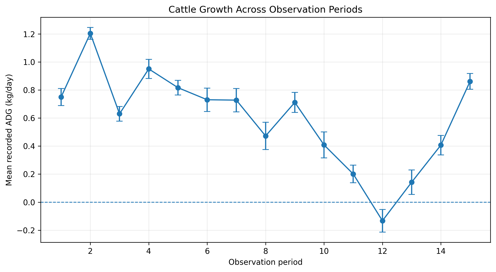
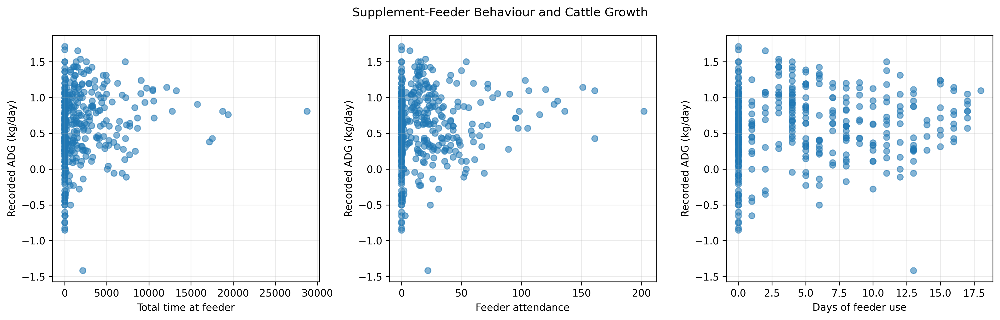
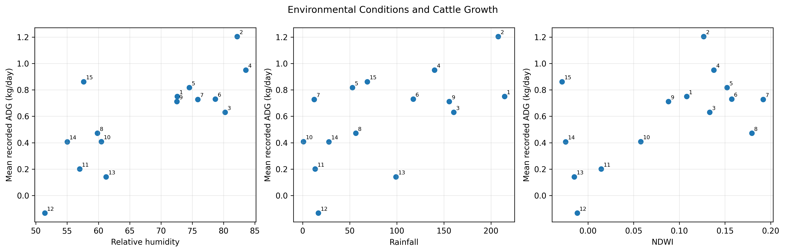

# Associations Between Cattle Growth, Supplement-Feeder Behaviour, and Environmental Conditions

**An exploratory animal science and agricultural data analysis project using Nelore cattle data from Brazil.**


## 1. Project Overview

Cattle growth is influenced by a combination of animal-level characteristics, feeding behaviour, nutritional management, and environmental conditions. Understanding how these factors relate to growth is an important component of animal science and livestock production research.

This project investigates associations between recorded average daily gain (ADG), supplement-feeder behaviour, and environmental indicators using a research dataset of Nelore cattle from Brazil.

The analysis examines variation in cattle growth across study periods, evaluates whether selected feeder-behaviour measurements are associated with recorded ADG after accounting for animal and period differences, and investigates relationships between environmental indicators and period-level mean growth.

The project combines descriptive statistics, fixed-effects modelling, correlation analysis, time-trend adjustment, sensitivity analysis, and scientific visualization. Particular attention is given to the structure of the data, the distinction between animal-level and period-level observations, and the limitations of drawing conclusions from a relatively small number of independent environmental observations.

Implemented using Python and Jupyter notebooks, this project demonstrates a reproducible analytical workflow for investigating livestock productivity and environmental variation using published agricultural research data.

The primary objective is not to establish causal relationships, but to evaluate the statistical evidence supported by the available observations and identify questions for further research.

## 2. Research Questions

The project addresses three principal research questions:

1. How does recorded average daily gain vary across the study periods?
2. Are supplement-feeder behaviour measurements associated with recorded cattle growth after accounting for animal and period differences?
3. Which environmental indicators are associated with period-level mean growth, and do these associations persist after accounting for a linear time trend?

These questions connect animal growth, feeding behaviour, and environmental conditions within a structured quantitative research framework.

## 3. Research Objectives

The specific objectives are to:

- Characterize the distribution and temporal variation of recorded average daily gain.
- Summarize growth patterns across the available study periods.
- Examine associations between supplement-feeder behaviour and recorded ADG.
- Account for animal-level and period-level differences in the feeder-behaviour analysis.
- Investigate relationships between environmental indicators and period-level mean ADG.
- Compare initial environmental correlations with correlations calculated after removing linear time trends.
- Evaluate the robustness of environmental associations using appropriate sensitivity checks.
- Communicate findings while distinguishing statistical significance, biological interpretation, and causal inference.
- Produce reproducible analytical outputs and visualizations suitable for scientific communication.

## 4. Dataset and Study Design

The analysis uses published research data obtained from Mendeley Data.

**Dataset:** [Nelore cattle research dataset — DOI 10.17632/3wdjvxmvsp.7](https://doi.org/10.17632/3wdjvxmvsp.7)

### Study characteristics

| Characteristic | Description |
|---|---|
| Animal type | Nelore cattle |
| Study location | Brazil |
| Number of animals | 26 |
| Number of study periods | 15 |
| Prepared observations | 390 |
| Study period | December 2022–October 2023 |
| Primary growth outcome | Recorded average daily gain (ADG) |
| Main explanatory variables | Supplement-feeder behaviour and environmental indicators |
| Prepared dataset dimensions | 390 observations × 76 columns |
| Analytical approach | Descriptive, fixed-effects, and correlational analysis |

The prepared dataset contains repeated observations associated with individual animals across multiple study periods.

The analysis distinguishes between two levels of investigation:

**Animal-level analysis:** Recorded ADG and feeder-behaviour measurements are examined while accounting for animal and period differences.

**Period-level environmental analysis:** Environmental indicators are compared with mean ADG aggregated across animals within each study period.

### An important consideration in the study design

Environmental indicators shared by animals within a given period do not represent independent environmental observations for every animal.

Although the prepared dataset contains 390 observations, the environmental analysis is based on only **15 independent study periods**.

This distinction is important because treating all 390 animal-level records as independent environmental observations would overstate the amount of independent information available for evaluating environmental associations.

The relatively small number of periods also limits statistical power and makes the environmental results sensitive to model assumptions and the characteristics of individual periods.

## 5. Analytical Workflow

The research workflow is organized into three notebooks, progressing from data quality assessment to statistical analysis and consolidated reporting.

### Notebook 1: Data Audit and Preparation

`notebooks/01_Nelore_Cattle_Data_Audit.ipynb`

This notebook establishes the foundation for the analysis by examining the structure and quality of the prepared research dataset.

The workflow includes:

- Inspecting dataset dimensions and variable names.
- Reviewing data types and measurement coverage.
- Checking missing values and duplicate records.
- Examining animal identifiers and study-period coverage.
- Reviewing the availability of growth, feeder-behaviour, and environmental variables.
- Preparing the dataset for subsequent statistical analysis.

The objective is to establish whether the available observations and variables are suitable for the intended research questions.

### Notebook 2: Growth and Association Analysis

`notebooks/02_Nelore_Cattle_Growth_and_Associations.ipynb`

This notebook investigates growth patterns and relationships between the main study variables.

The analysis includes:

- Descriptive summaries of recorded ADG.
- Comparisons of mean growth across study periods.
- Fixed-effects models examining feeder-behaviour associations.
- Correlations between environmental indicators and period-level mean ADG.
- Time-adjusted correlations based on detrended variables.
- Statistical interpretation of the observed relationships.

The notebook distinguishes animal-level analyses from period-level environmental analyses to avoid treating observations at different analytical levels as interchangeable.

### Notebook 3: Final Results and Visualization

`notebooks/03_Nelore_Cattle_Final_Results_and_Dashboard.ipynb`

This notebook consolidates the main analytical outputs into research-ready tables and figures.

Its intended functions include:

- Summarizing the principal growth findings.
- Consolidating feeder-behaviour model results.
- Presenting environmental correlation and time-adjusted correlation results.
- Generating figures for scientific communication.
- Exporting final result tables.
- Supporting consistent reporting across the repository.

Together, the three notebooks provide a structured workflow from data preparation to interpretation and reporting.

## 6. Statistical Methods

### 6.1 Descriptive statistics

Descriptive statistics were used to characterize recorded ADG and examine variation in mean growth across study periods.

This approach provides an overview of the distribution and temporal variability of the primary growth outcome.

### 6.2 Fixed-effects modelling

Fixed-effects models were used to investigate associations between selected supplement-feeder behaviour measurements and recorded ADG while accounting for animal and period differences.

The reported feeder-behaviour measures included:

- Total feeder time.
- Total attendance.
- Total days.

The purpose of this analysis was to examine whether the selected behavioural measurements were statistically associated with recorded growth after accounting for the specified differences.

The interpretation of the coefficients and statistical tests depends on the model specification, variable definitions, and assumptions documented in the analytical notebook.

### 6.3 Environmental correlation analysis

Pearson correlation was used to examine linear relationships between environmental indicators and period-level mean ADG.

The reported environmental indicators included:

- Relative humidity.
- Rainfall.
- Normalized Difference Water Index (NDWI).

The environmental analysis was conducted at the study-period level, reflecting the fact that the environmental measurements were shared across animals within each period.

### 6.4 Time-adjusted correlation analysis

The environmental associations were also examined after removing linear trends from both variables.

This approach evaluates whether the observed association remains after accounting for their fitted linear temporal patterns.

A persistent association after detrending provides evidence that the relationship is not explained solely by the removed linear trends. However, detrending does not eliminate all potential confounding, temporal dependence, or other sources of bias.

### 6.5 Statistical interpretation

The results were interpreted using the reported coefficient estimates, p-values, and analytical context.

Statistical significance was assessed using the conventional 5% threshold in the reported results.

A non-significant finding does not establish that an association is absent. Likewise, a statistically significant association does not establish a causal effect or necessarily imply biological importance.

## 7. Key Findings

### 7.1 Variation in cattle growth

Mean recorded ADG across the prepared observations was approximately **0.592 kg/day**.

Period-level mean growth varied substantially, ranging from approximately **−0.13 to 1.20 kg/day**.

This variation indicates that the overall mean alone does not fully describe the observed growth patterns.

Examining period-level changes provides additional information about temporal variation, although the available data do not independently establish the causes of that variation.

### 7.2 Supplement-feeder behaviour and recorded growth

The fitted fixed-effects models did not detect statistically significant associations between the examined feeder-behaviour variables and recorded ADG.

| Feeder-behaviour measure | Reported p-value | Statistical interpretation |
|---|---:|---|
| Total feeder time | 0.486 | Not statistically significant |
| Total attendance | 0.738 | Not statistically significant |
| Total days | 0.760 | Not statistically significant |

All three reported p-values exceed 0.05.

Under the fitted models, the analysis therefore did not provide sufficient statistical evidence of associations between these feeder-behaviour measures and recorded ADG.

These findings should not be interpreted as proof that feeder behaviour is biologically unimportant or unrelated to cattle growth. The results are specific to the variables, dataset, sample size, and statistical models examined.

### 7.3 Environmental associations with cattle growth

The environmental analysis examined associations between relative humidity, rainfall, NDWI, and period-level mean ADG after removing linear time trends.

| Environmental indicator | Time-adjusted Pearson correlation (r) | Reported p-value |
|---|---:|---:|
| Relative humidity | 0.614 | 0.015 |
| Rainfall | 0.310 | 0.260 |
| NDWI | 0.164 | 0.559 |

The reported results show that relative humidity retained a positive, statistically significant time-adjusted association with period-level mean ADG.

The corresponding time-adjusted associations for rainfall and NDWI were not statistically significant at the 5% level.

### Interpretation of the environmental findings

**Relative humidity:** The positive time-adjusted correlation suggests that periods with higher relative humidity tended to coincide with higher period-level mean ADG after removing linear time trends.

**Rainfall:** The estimated correlation was positive, but the reported p-value did not provide sufficient evidence of a statistically significant linear association after detrending.

**NDWI:** The estimated association was weakly positive and not statistically significant under the reported analysis.

The relative-humidity finding is exploratory. With only 15 independent study periods, the estimate may be sensitive to individual observations and the assumptions of the statistical procedure.

It should not be interpreted as evidence that humidity causes increased cattle growth.

## 8. Research Figures

The repository includes three principal figures intended to summarize the growth patterns, feeder-behaviour analysis, and environmental associations.

### Figure 1. Cattle Growth Across Study Periods



*Figure 1. Recorded average daily gain across the study periods, illustrating temporal variation in cattle growth.*

This figure summarizes the observed variation in recorded ADG across the study periods.

The visualization provides a descriptive overview of changes in growth over time and complements the overall mean ADG.

The observed variation does not independently identify the factors responsible for changes in growth.

### Figure 2. Supplement-Feeder Behaviour and Growth



*Figure 2. Visual summary of the examined feeder-behaviour measures and their associations with recorded ADG.*

This figure presents the feeder-behaviour analysis, supporting the examination of relationships between behavioural measurements and recorded cattle growth.

The reported fixed-effects models did not detect statistically significant associations for total feeder time, total attendance, or total days.

The visual results should be interpreted alongside the model specifications and reported statistical outputs.

### Figure 3. Environmental Indicators and Growth



*Figure 3. Summary of environmental associations with period-level mean ADG, including initial and time-adjusted correlations.*

This figure compares environmental indicators with period-level mean growth and illustrates the distinction between initial and time-adjusted associations.

Relative humidity retained a positive time-adjusted association with mean ADG, while the reported rainfall and NDWI associations were not statistically significant.

The environmental analysis is based on 15 study periods, so the results should be treated as exploratory rather than definitive evidence of environmental effects.

## 9. Exported Research Outputs

The repository includes three exported tables summarizing the principal findings.

### `final_growth_summary.csv`

This file contains the consolidated growth summaries generated by the analysis.

Its purpose is to document the principal descriptive results for recorded ADG and growth across study periods.

### `final_feeder_results.csv`

This file contains the reported results of the feeder-behaviour analysis.

It supports examination of the associations between feeder-behaviour measurements and recorded ADG under the fitted fixed-effects models.

### `final_environment_results.csv`

This file contains the consolidated environmental association results.

It supports comparison of the environmental indicators and the reported time-adjusted correlations with period-level mean ADG.

The exported tables should be interpreted alongside the analytical notebooks, which document the relevant variables, calculations, and statistical procedures.

## 10. Limitations and Scientific Interpretation

### 10.1 Limited environmental sample size

The environmental analysis is based on 15 study periods, not 390 independent environmental observations.

This limits the amount of independent information available for estimating environmental associations and reduces statistical power.

### 10.2 Observational research design

The analysis identifies statistical associations rather than causal relationships.

The observed association between relative humidity and mean ADG does not establish that humidity caused changes in cattle growth.

### 10.3 Temporal variation

Environmental variables and cattle growth may both change over time.

Removing linear trends helps address one aspect of temporal structure, but it does not account for all potential sources of temporal dependence or confounding.

### 10.4 Generalizability

The findings are based on a particular Nelore cattle dataset and study setting in Brazil.

They should not automatically be generalized to other cattle breeds, production systems, geographic locations, or management conditions.

### 10.5 Statistical uncertainty

The absence of statistical significance does not prove that an association is absent.

Similarly, a statistically significant result should be evaluated in the context of the sample size, model assumptions, effect magnitude, and biological plausibility.

### 10.6 Interpretation of environmental indicators

Relative humidity, rainfall, and NDWI describe different aspects of the environmental conditions represented in the dataset.

Their associations with cattle growth may reflect multiple interacting processes. The current analysis does not establish the specific biological mechanisms responsible for the observed relationships.

These limitations are central to responsible interpretation and help identify priorities for future research.

## 11. Reproducibility

Reproducibility is an important part of quantitative agricultural research. This project uses a structured notebook workflow and exported result tables to support inspection of the analytical procedures.

The repository includes the prepared dataset, three analysis notebooks, selected result tables, and research figures.

### Steps to reproduce the analysis

1. Clone or download the GitHub repository.
2. Review the repository structure and the data-loading instructions in the notebooks.
3. Open the notebooks in Google Colab or a compatible Jupyter environment.
4. Install the required Python dependencies.
5. Execute the notebooks in their intended sequence, beginning with the data audit.
6. Inspect the generated statistical outputs and visualizations.
7. Compare the outputs with the exported result tables.

Reproduction depends on the actual data files, file paths, dependency versions, and procedures documented in the notebooks.

### Tools and technologies

- **Python:** Scientific computing and data analysis.
- **pandas:** Data preparation and tabular analysis.
- **NumPy:** Numerical operations.
- **SciPy:** Statistical analysis.
- **statsmodels:** Statistical modelling.
- **Matplotlib:** Research visualization.
- **Jupyter Notebook:** Documentation and execution of the analytical workflow.
- **GitHub:** Version control, project documentation, and portfolio presentation.

## 12. Repository Structure

```text
nelore-cattle-growth-environment/
├── data/
│   ├── nelore_cattle_prepared.csv
│   ├── final_growth_summary.csv
│   ├── final_feeder_results.csv
│   └── final_environment_results.csv
├── notebooks/
│   ├── 01_Nelore_Cattle_Data_Audit.ipynb
│   ├── 02_Nelore_Cattle_Growth_and_Associations.ipynb
│   └── 03_Nelore_Cattle_Final_Results_and_Dashboard.ipynb
├── image/
│   ├── figure1_cattle_growth.png
│   ├── figure2_feeder_behaviour.png
│   └── figure3_environmental_associations.png
└── README.md
```

The structure above reflects the project layout supplied for this analysis. Confirm that the listed files exist in the repository before publishing.

## 13. Future Research Directions

The current analysis provides a foundation for several potential extensions.

### Longitudinal growth modelling

Investigate growth trajectories using statistical models that explicitly account for repeated observations within animals and the structure of the study periods.

### Expanded feeder-behaviour analysis

Evaluate additional behavioural variables and model specifications where supported by the dataset, while maintaining appropriate control for animal and period differences.

### Environmental sensitivity analysis

Examine whether environmental associations are sensitive to alternative specifications, influential periods, or additional time-related adjustments.

### Larger independent environmental datasets

Investigate datasets containing more independent periods and environmental variation to improve the precision and generalizability of environmental association estimates.

### Integration of additional environmental variables

Where suitable data are available, investigate additional environmental indicators that may help explain variation in livestock growth.

These are proposed extensions rather than completed analyses.

## 14. Relevance to Animal Science and Agricultural Data Research

This project connects animal science with quantitative agricultural research by applying statistical methods to questions involving cattle growth, feeding behaviour, and environmental variation.

It demonstrates the ability to:

- Work with structured agricultural research datasets.
- Perform data auditing and quality assessment.
- Distinguish between animal-level and period-level analyses.
- Apply fixed-effects models and correlation analysis.
- Examine associations after removing linear time trends.
- Interpret statistical results in light of sample size and study design.
- Develop reproducible research notebooks and visualizations.
- Communicate findings while acknowledging uncertainty and limitations.

These skills are relevant to research in animal nutrition, livestock production, animal behaviour, agricultural systems, and quantitative approaches to agricultural science.

## 15. Conclusion

This project examines variation in Nelore cattle growth, evaluates supplement-feeder behaviour associations, and investigates environmental relationships using published research data from Brazil.

Mean recorded ADG was approximately 0.592 kg/day, with substantial variation in period-level mean growth.

The fitted fixed-effects models did not detect statistically significant associations between the examined feeder-behaviour measurements and recorded ADG.

In the environmental analysis, relative humidity showed a positive time-adjusted association with period-level mean ADG, whereas the reported rainfall and NDWI associations were not statistically significant.

These findings should be interpreted as exploratory because the environmental analysis is based on only 15 independent periods and the research design does not establish causation.

Overall, the project demonstrates a structured and reproducible approach to agricultural data analysis, combining descriptive statistics, statistical modelling, sensitivity to temporal trends, and scientific communication.

## 16. About the Author

**Richard Antwi**

BSc in Agriculture, majoring in Animal Science

Research interests include animal nutrition, livestock growth and production, animal behaviour, environmental influences on agricultural systems, and quantitative approaches to agricultural research.

This project forms part of my agricultural research portfolio, demonstrating the application of data analysis and statistical reasoning to animal science questions.

---

**Dataset:** [Mendeley Data — DOI 10.17632/3wdjvxmvsp.7](https://doi.org/10.17632/3wdjvxmvsp.7)

**Study subject:** Nelore cattle growth, supplement-feeder behaviour, and environmental conditions.

**Research approach:** Exploratory secondary-data analysis.

*The results should be interpreted in the context of the original study design, the limited number of independent environmental periods, and the statistical limitations documented in this README.*
